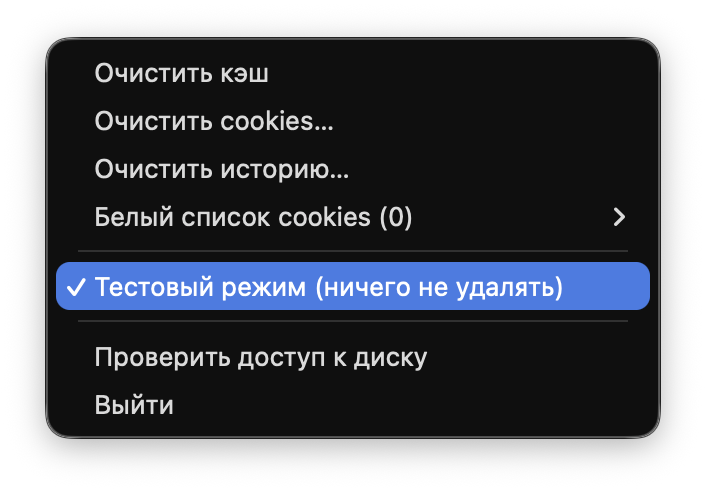

# Safari Cleaner


Маленькое приложение в строке меню macOS для очистки Safari в один клик: кэш, cookies с данными сайтов, история. Есть тестовый режим, который только показывает, что *будет* удалено, и белый список сайтов, чьи cookies трогать нельзя.



*[English version](README.en.md)*

## Требования

- macOS 14 Sonoma или новее.
- Mac на Apple Silicon (M1 и новее) или на Intel: приложение собирается сразу для обоих.
- Инструменты разработчика Xcode Command Line Tools (бесплатно, ставятся одной командой, см. ниже). Полный Xcode не нужен.

## Установка из исходников

1. **Поставьте Command Line Tools.** Откройте «Терминал» и выполните:
   ```
   xcode-select --install
   ```
   Появится окно установки, нажмите «Установить». Если инструменты уже стоят, команда так и скажет, это нормально.

2. **Скачайте код:**
   ```
   git clone https://github.com/danecom7/safari-cleaner.git
   cd safari-cleaner
   ```

3. **Соберите приложение:**
   ```
   ./build.sh
   ```
   Сборка занимает 1–2 минуты. Результат: `build/SafariCleaner.app`.

4. **Перенесите в «Программы»:**
   ```
   cp -R build/SafariCleaner.app /Applications/
   ```
   Или перетащите `SafariCleaner.app` из папки `build` в «Программы» в Finder.

5. **Запустите** Safari Cleaner из «Программ». Окна у приложения нет: в строке меню справа появится значок компаса.

### О подписи

Если в Связке ключей есть сертификат «Apple Development» (он бывает у тех, кто входил в Xcode со своим Apple ID), `build.sh` подпишет приложение им. Тогда «Полный доступ к диску» сохраняется после пересборки.

Если сертификата нет, а у большинства его нет, приложение подписывается локально. Оно работает точно так же, но после **каждой пересборки** macOS считает его новым приложением, и «Полный доступ к диску» нужно включить заново. Выбрать конкретный сертификат можно так: `SIGN_IDENTITY="..." ./build.sh`.

## Первый запуск: «Полный доступ к диску»

macOS закрывает папки Safari от всех программ, поэтому без этого разрешения приложение ничего не увидит. Сделать один раз:

1. Откройте **Системные настройки → Конфиденциальность и безопасность → Полный доступ к диску**.
2. Нажмите «+» внизу списка и выберите **SafariCleaner** в «Программах». Если приложение уже есть в списке, просто включите переключатель.
3. Перезапустите Safari Cleaner: значок в строке меню → «Выйти», затем откройте снова.

Проверить: значок → «Проверить доступ к диску». Если доступа нет, приложение само предложит открыть нужный раздел настроек.

## Как пользоваться

### Тестовый режим

При **каждом** запуске приложение включается в тестовом режиме: галочка «Тестовый режим (ничего не удалять)» в меню стоит. Любая кнопка в этом режиме только показывает отчёт: что будет удалено и сколько места освободится. Ничего не удаляется, Safari закрывать не нужно.

Чтобы удалить по-настоящему, снимите галочку и нажмите кнопку ещё раз. Перед настоящей очисткой приложение попросит закрыть Safari (так же, как ⌘Q). Если Safari не закрылся, очистка отменяется и ничего не удаляется.

Совет: сначала посмотрите отчёт в тестовом режиме, потом удаляйте.

### Белый список cookies

Чтобы не выходить из аккаунтов на важных сайтах, добавьте их в белый список: меню → «Белый список cookies» → «Добавить сайт…».

- Сайт записывается по домену: `google.com` сохраняет cookies и данные `google.com`, `mail.google.com`, `accounts.google.com` и других поддоменов.
- Можно вставить и полный адрес, например `https://www.google.com/mail`: приложение само возьмёт из него `google.com`.
- Удалить сайт из списка: то же меню → выберите сайт → «Удалить из белого списка».

Список хранится у вас на Mac в `~/Library/Application Support/SafariCleaner/whitelist.json` и никуда не отправляется.

Если в белом списке есть сайты, файл cookies не удаляется целиком, а пересобирается: в нём остаются только cookies сайтов из списка. Прежде чем что-то менять, приложение проверяет, что умеет собрать из разобранного файла точную копию оригинала, байт в байт. Если не получается, cookies не трогаются. Перед заменой файла делается резервная копия: при ошибке она возвращается на место, при успехе удаляется.

## Что удаляет каждая кнопка

| Кнопка | Что удаляется | Где лежит |
|---|---|---|
| **Очистить кэш** | кэш страниц, кэш WebKit, превью | `~/Library/Containers/com.apple.Safari/Data/Library/Caches/com.apple.Safari/*`, `…/Caches/WebKit/NetworkCache`, старый кэш в `~/Library/Caches/com.apple.Safari` |
| **Очистить cookies…** | cookies Safari и данные сайтов (Local Storage, IndexedDB, WebSQL, Cache Storage), кроме сайтов из белого списка. Вы выйдете из аккаунтов на сайтах | `~/Library/Cookies/Cookies.binarycookies`, `…/WebKit/WebsiteData/{Default,IndexedDB,LocalStorage,WebSQL}`, `…/Caches/WebKit/CacheStorage` |
| **Очистить историю…** | посещения за выбранный период (последний час, сегодня, всё время), страницы, у которых не осталось посещений, значки сайтов | `~/Library/Safari/History.db` (+ `-wal`, `-shm`), `~/Library/Safari/Favicon Cache` |

История удаляется аккуратно, через саму базу данных, а не удалением файла: сначала делается резервная копия, потом удаляются записи, потом файл сжимается и проверяется на целостность. При любой ошибке резервная копия возвращается на место.

### Что приложение никогда не трогает

Закладки, вкладки (в том числе недавно закрытые), пароли, автозаполнение форм, настройки Safari, расширения, данные синхронизации iCloud (CloudKit), HSTS, cookies других программ. Защита в коде (`SafariPaths.swift`) отклоняет любой путь вне таблицы выше, любой путь через ссылку-ярлык и любые файлы с этими именами.

## ⚠️ iCloud и история

Если в настройках iCloud включена синхронизация Safari, история общая для всех ваших устройств. Safari Cleaner удаляет историю **только на этом Mac**. На iPhone и iPad она останется и при следующей синхронизации **может вернуться** на Mac.

Чтобы удалить историю везде, очистите её и на других устройствах (на iPhone: Настройки → Приложения → Safari → «Очистить историю и данные сайтов»). Можно и выключить синхронизацию Safari в iCloud.

## Как удалить приложение

1. Значок в строке меню → «Выйти».
2. Удалите `SafariCleaner.app` из «Программ» (перетащите в Корзину).
3. Удалите папку с настройками (там только белый список):
   ```
   rm -rf ~/Library/Application\ Support/SafariCleaner
   ```
4. В **Системных настройках → Конфиденциальность и безопасность → Полный доступ к диску** выберите SafariCleaner и нажмите «−».

Больше приложение ничего на Mac не оставляет.

## Для разработчиков

- Код на Swift и SwiftUI, сборка через Swift Package Manager (`Package.swift`), без проекта Xcode.
- Иконка: исходник `Resources/AppIcon.svg`. После правки пересоберите `Resources/AppIcon.icns` командой `./make-icon.sh` (нужен `brew install librsvg`).

## Лицензия

[MIT](LICENSE)
